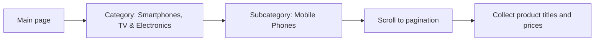

🌐 **English**
# Rozetka UI Tests — Mobile Phones

Automated UI tests for the [rozetka.com.ua](https://rozetka.com.ua) online store, written as a test assignment. The project implements the **Page Object** pattern on top of **Selenide** + **TestNG**, with logging (Log4j) and reporting (Allure).

---

## Table of Contents

1. [What the Tests Cover](#what-the-tests-cover)
2. [Tech Stack](#tech-stack)
3. [Project Structure](#project-structure)
4. [Architecture](#architecture)
5. [Prerequisites](#prerequisites)
6. [Configuration](#configuration)
7. [Running the Tests](#running-the-tests)
8. [Allure Reports](#allure-reports)
9. [Logging](#logging)
10. [Adding a New Test](#adding-a-new-test)
11. [Known Limitations](#known-limitations)

---

## What the Tests Cover

The `MobilePhonesTest` class contains two scenarios. Both start with the same navigation:

1. Open the main page `https://rozetka.com.ua`.
2. In the left-hand catalog, select the category **"Смартфони, ТВ і електроніка"** (Smartphones, TV & Electronics) and verify the page URL and heading.
3. Go to the subcategory **"Мобільні телефони"** (Mobile Phones) and verify the redirect URL.
4. Scroll down to the pagination so that all product cards are loaded.

| Test | Description |
| --- | --- |
| `getProductsTitleAndPricesTest` | Collects the **title** and **price** of every product on the first catalog page and prints them to the console. |
| `getTopSalesProductsTitleAndPricesTest` | Collects the title and price only of products marked with the **"Топ продажів"** (Top Sales) label. |



---

## Tech Stack

| Tool | Version | Purpose |
| --- | --- | --- |
| Java | 19 | Programming language |
| Maven | 3.6+ | Build and dependency management |
| [Selenide](https://selenide.org) | 7.5.1 | Wrapper over Selenium WebDriver, smart waits |
| [TestNG](https://testng.org) | 7.6.1 | Test framework, parallel execution |
| Maven Surefire Plugin | 3.0.0-M5 | Running TestNG suites |
| [Allure TestNG](https://allurereport.org) | 2.16.0 | Reporting (`@Step`, `@Attachment`, screenshots) |
| Allure Maven Plugin | 2.10.0 | Generating and viewing the report via Maven |
| AspectJ Weaver | 1.9.19 | Makes Allure annotations (`@Step`, `@Attachment`) work |
| Lombok | 1.18.32 | Getter generation (`@Getter`) |
| Log4j | 1.2.17 | Logging of test execution |
| Chrome / ChromeDriver | latest | Browser used for execution |

---

## Project Structure

```
.
├── pom.xml
├── README.md
└── src
    ├── main
    │   └── java
    │       ├── base
    │       │   └── BasePage.java              # base element lookup methods
    │       ├── components
    │       │   └── Pagination.java            # reusable pagination component
    │       ├── constants
    │       │   └── PageUrls.java              # URL fragments for assertions
    │       ├── enums
    │       │   ├── CategorySidebar.java       # sidebar categories
    │       │   └── Subcategory.java           # subcategories
    │       ├── models
    │       │   └── Product.java               # product model (title, price)
    │       ├── pages
    │       │   ├── MainPage.java              # main page
    │       │   ├── CategoryPage.java          # category page
    │       │   └── MobilePhonesPage.java      # mobile phones catalog
    │       └── utils
    │           └── SuiteConfiguration.java    # reads config.properties
    └── test
        ├── java
        │   ├── listeners
        │   │   └── Listener.java              # TestNG listener for logging
        │   └── tests
        │       ├── TestInit.java              # base class: browser setup and teardown
        │       └── MobilePhonesTest.java      # tests
        └── resources
            ├── config.properties              # run parameters (headless)
            ├── log4j.properties               # logging configuration
            └── suites
                └── regression.xml             # TestNG suite
```

---

## Architecture

The project is split into layers, each with a single responsibility:

```
 Tests (MobilePhonesTest)
        │  use
        ▼
 Page Objects (MainPage, CategoryPage, MobilePhonesPage)  ◄── Components (Pagination)
        │  extend
        ▼
 BasePage (explicit waits, XPath lookup)
        │
        ▼
 Selenide → Selenium WebDriver → Chrome
```

| Layer | Classes | Role |
| --- | --- | --- |
| **Tests** | `MobilePhonesTest`, `TestInit` | Scenarios and browser lifecycle |
| **Pages** | `MainPage`, `CategoryPage`, `MobilePhonesPage` | Locators and actions of specific pages |
| **Components** | `Pagination` | UI parts that repeat across different pages |
| **Base** | `BasePage` | Shared element lookup methods with waits (15 s) |
| **Models** | `Product` | Immutable product data object |
| **Enums / Constants** | `CategorySidebar`, `Subcategory`, `PageUrls` | Test data without "magic strings" in tests |
| **Utils** | `SuiteConfiguration` | Loading settings from `.properties` |
| **Listeners** | `Listener` | Logging of test start, success, and failure |

Key principles:

- **Page Object** — tests contain no locators, only calls to page methods.
- **Fluent interface** — `CategoryPage` methods return `this`, allowing call chaining.
- **Selenide lazy elements** — elements (`$x`, `$$x`) are located on access, not when the Page Object is created.
- **Test independence** — the browser is opened in `@BeforeMethod` and closed in `@AfterMethod`.

---

## Prerequisites

- **JDK 19** (`maven.compiler.source/target = 19`)
- **Maven 3.6+**
- **Google Chrome** (latest version; Selenide picks the driver automatically)
- Internet access and access to `rozetka.com.ua`
- On the first run Maven downloads `aspectjweaver` into the local `~/.m2` repository — it is required as a `-javaagent` for Allure

Verification:

```bash
java -version
mvn -version
```

---

## Configuration

### Maven Profiles (browser mode)

`pom.xml` defines two profiles that set the `headless` property:

| Profile | `headless` | Description |
| --- | --- | --- |
| `headlessTrue` | `true` | Browser without a graphical interface (for CI) |
| `headlessFalse` | `false` | Regular browser with a window (for local runs) |

### `src/test/resources/config.properties`

```properties
headless=${headless}
```

The `src/test/resources` directory is processed by Maven with **filtering** enabled, so `${headless}` is substituted from the active profile (or from the `-Dheadless=...` parameter).

| Parameter | Value | Note |
| --- | --- | --- |
| `headless` | `true` / `false` | Read in `TestInit`. If no profile is specified, the literal `${headless}` stays in the file and is interpreted as `false`. |

### Choosing a Suite

The path to the TestNG suite is built in `pom.xml` as `src/test/resources/suites/${suiteXmlFile}`, so the **`-DsuiteXmlFile` parameter is required** (for example, `-DsuiteXmlFile=regression.xml`).

### Selenide Settings (in `TestInit`)

| Parameter | Value |
| --- | --- |
| `Configuration.timeout` | 10,000 ms |
| `Configuration.pollingInterval` | 500 ms |
| `Configuration.screenshots` | `true` |

A custom path to the configuration file can be passed via the system property `-Dconfig.properties=/my-config.properties`.

---

## Running the Tests

### Locally (with a browser window)

```bash
mvn clean test -PheadlessFalse -DsuiteXmlFile=regression.xml
```

### Headless Mode (for CI)

```bash
mvn clean test -PheadlessTrue -DsuiteXmlFile=regression.xml
```

### A Single Test

```bash
mvn clean test -PheadlessFalse -DsuiteXmlFile=regression.xml \
    -Dtest=MobilePhonesTest#getProductsTitleAndPricesTest
```

### Example Console Output

```
Items received: 60
----------------------------------------
1. Назва: 'Смартфон Samsung Galaxy A55 8/256GB' | Ціна: 18999₴ грн
2. ...
```

### The `regression.xml` Suite

```xml
<suite name="RegressionTests" parallel="methods" thread-count="2">
    <test name="MobilePhonesTests">
        <classes>
            <class name="tests.MobilePhonesTest"/>
        </classes>
    </test>
</suite>
```

Tests run in parallel at the method level; each thread works with its own browser instance. `Listener` is attached via `@Listeners` in `TestInit`, so it does not need to be declared in the suite.

---

## Allure Reports

Run results are saved to `target/allure-results`.

```bash
# open the report in the browser (no Allure CLI needed — downloaded by the plugin)
mvn allure:serve

# or generate a static report in target/allure-reports/
mvn allure:report
```

The report includes:

- steps annotated with `@Step` (for example, "Retrieve product titles and prices…");
- a page screenshot (`@Attachment`) for tests that failed or were skipped.

`@Step` and `@Attachment` work thanks to AspectJ Weaver, which is attached in the Surefire plugin's `argLine`.

---

## Logging

Logs are written to the console in the following format:

```
2026-10-20 12:00:00 INFO  Listener:15 - testMethodName -Start
```

`Listener` (attached via `@Listeners` in `TestInit`) logs:

- the start and end of the suite (`onStart` / `onFinish`);
- the start, success, and failure of each test;
- the test description (the `description` from the `@Test` annotation).

The level and format can be changed in `src/test/resources/log4j.properties`.

---

## Adding a New Test

1. **New subcategory** — add a value to `enums/Subcategory.java` and the URL fragment to `constants/PageUrls.java`.
2. **New page** — create a class in `pages` that extends `BasePage`, with locators and action methods.
3. **New test** — create a class in `src/test/java/tests` that extends `TestInit`, and add it to `suites/regression.xml`:

```java
public class TvTest extends TestInit {
    MainPage mainPage = new MainPage();
    CategoryPage categoryPage = new CategoryPage();

    @Test(description = "Open TV subcategory")
    public void openTvSubcategoryTest() {
        mainPage.clickOnCategory(CategorySidebar.ELECTRONICS);
        categoryPage.clickOnSubcategoryByText(Subcategory.TV.getName());
    }
}
```

```xml
<class name="tests.TvTest"/>
```

---

## Known Limitations

- **Anti-bot protection.** The site may show a captcha or block automated traffic; a custom `User-Agent` is set for headless mode.
- **Dynamic content.** The catalog contents, prices, and the presence of "Top Sales" labels change daily, so the tests output the data rather than compare it against a reference.

---

🌐 **Українська**
# Rozetka UI Tests — Mobile Phones

Автоматизовані UI-тести для інтернет-магазину [rozetka.com.ua](https://rozetka.com.ua), написані як тестове завдання. Проєкт реалізує патерн **Page Object** на базі **Selenide** + **TestNG**, з логуванням (Log4j) та звітністю (Allure).

---

## Зміст

1. [Що перевіряють тести](#%D1%89%D0%BE-%D0%BF%D0%B5%D1%80%D0%B5%D0%B2%D1%96%D1%80%D1%8F%D1%8E%D1%82%D1%8C-%D1%82%D0%B5%D1%81%D1%82%D0%B8)
2. [Технологічний стек](#%D1%82%D0%B5%D1%85%D0%BD%D0%BE%D0%BB%D0%BE%D0%B3%D1%96%D1%87%D0%BD%D0%B8%D0%B9-%D1%81%D1%82%D0%B5%D0%BA)
3. [Структура проєкту](#%D1%81%D1%82%D1%80%D1%83%D0%BA%D1%82%D1%83%D1%80%D0%B0-%D0%BF%D1%80%D0%BE%D1%94%D0%BA%D1%82%D1%83)
4. [Архітектура](#%D0%B0%D1%80%D1%85%D1%96%D1%82%D0%B5%D0%BA%D1%82%D1%83%D1%80%D0%B0)
5. [Передумови](#%D0%BF%D0%B5%D1%80%D0%B5%D0%B4%D1%83%D0%BC%D0%BE%D0%B2%D0%B8)
6. [Конфігурація](#%D0%BA%D0%BE%D0%BD%D1%84%D1%96%D0%B3%D1%83%D1%80%D0%B0%D1%86%D1%96%D1%8F)
7. [Запуск тестів](#%D0%B7%D0%B0%D0%BF%D1%83%D1%81%D0%BA-%D1%82%D0%B5%D1%81%D1%82%D1%96%D0%B2)
8. [Звіти Allure](#%D0%B7%D0%B2%D1%96%D1%82%D0%B8-allure)
9. [Логування](#%D0%BB%D0%BE%D0%B3%D1%83%D0%B2%D0%B0%D0%BD%D0%BD%D1%8F)
10. [Як додати новий тест](#%D1%8F%D0%BA-%D0%B4%D0%BE%D0%B4%D0%B0%D1%82%D0%B8-%D0%BD%D0%BE%D0%B2%D0%B8%D0%B9-%D1%82%D0%B5%D1%81%D1%82)
11. [Відомі обмеження](#%D0%B2%D1%96%D0%B4%D0%BE%D0%BC%D1%96-%D0%BE%D0%B1%D0%BC%D0%B5%D0%B6%D0%B5%D0%BD%D0%BD%D1%8F)

---

## Що перевіряють тести

Клас `MobilePhonesTest` містить два сценарії. Обидва починаються з однакової навігації:

1. Відкрити головну сторінку `https://rozetka.com.ua`.
2. У каталозі зліва вибрати категорію **«Смартфони, ТВ і електроніка»** і перевірити URL та заголовок сторінки.
3. Перейти в підкатегорію **«Мобільні телефони»** і перевірити URL редиректу.
4. Прокрутити сторінку до пагінації, щоб підвантажилися всі картки товарів.

| Тест | Опис |
| --- | --- |
| `getProductsTitleAndPricesTest` | Збирає **назву** та **ціну** всіх товарів з першої сторінки каталогу й виводить їх у консоль. |
| `getTopSalesProductsTitleAndPricesTest` | Збирає назву та ціну лише тих товарів, що мають мітку **«Топ продажів»**. |


---

## Технологічний стек

| Інструмент | Версія | Призначення |
| --- | --- | --- |
| Java | 19 | Мова програмування |
| Maven | 3.6+ | Збірка та керування залежностями |
| [Selenide](https://selenide.org) | 7.5.1 | Обгортка над Selenium WebDriver, розумні очікування |
| [TestNG](https://testng.org) | 7.6.1 | Тестовий фреймворк, паралельний запуск |
| Maven Surefire Plugin | 3.0.0-M5 | Запуск TestNG-сюїт |
| [Allure TestNG](https://allurereport.org) | 2.16.0 | Звітність (`@Step`, `@Attachment`, скріншоти) |
| Allure Maven Plugin | 2.10.0 | Генерація та перегляд звіту через Maven |
| AspectJ Weaver | 1.9.19 | Робота анотацій Allure (`@Step`, `@Attachment`) |
| Lombok | 1.18.32 | Генерація геттерів (`@Getter`) |
| Log4j | 1.2.17 | Логування ходу виконання тестів |
| Chrome / ChromeDriver | актуальна | Браузер для запуску |

---

## Структура проєкту

```
.
├── pom.xml
├── README.md
└── src
    ├── main
    │   └── java
    │       ├── base
    │       │   └── BasePage.java              # базові методи пошуку елементів
    │       ├── components
    │       │   └── Pagination.java            # перевикористовуваний компонент пагінації
    │       ├── constants
    │       │   └── PageUrls.java              # фрагменти URL для перевірок
    │       ├── enums
    │       │   ├── CategorySidebar.java       # категорії бічного меню
    │       │   └── Subcategory.java           # підкатегорії
    │       ├── models
    │       │   └── Product.java               # модель товару (назва, ціна)
    │       ├── pages
    │       │   ├── MainPage.java              # головна сторінка
    │       │   ├── CategoryPage.java          # сторінка категорії
    │       │   └── MobilePhonesPage.java      # каталог мобільних телефонів
    │       └── utils
    │           └── SuiteConfiguration.java    # читання config.properties
    └── test
        ├── java
        │   ├── listeners
        │   │   └── Listener.java              # TestNG-лістенер для логування
        │   └── tests
        │       ├── TestInit.java              # базовий клас: налаштування й закриття браузера
        │       └── MobilePhonesTest.java      # тести
        └── resources
            ├── config.properties              # параметри запуску (headless)
            ├── log4j.properties               # конфігурація логування
            └── suites
                └── regression.xml             # TestNG-сюїта
```

---

## Архітектура

Проєкт розділений на шари, кожен з яких має одну відповідальність:

```
 Тести (MobilePhonesTest)
        │  використовують
        ▼
 Page Objects (MainPage, CategoryPage, MobilePhonesPage)  ◄── Components (Pagination)
        │  наслідують
        ▼
 BasePage (явні очікування, пошук за XPath)
        │
        ▼
 Selenide → Selenium WebDriver → Chrome
```

| Шар | Класи | Роль |
| --- | --- | --- |
| **Tests** | `MobilePhonesTest`, `TestInit` | Сценарії та життєвий цикл браузера |
| **Pages** | `MainPage`, `CategoryPage`, `MobilePhonesPage` | Локатори й дії конкретних сторінок |
| **Components** | `Pagination` | Частини UI, що повторюються на різних сторінках |
| **Base** | `BasePage` | Спільні методи пошуку елементів з очікуваннями (15 с) |
| **Models** | `Product` | Незмінний (immutable) об'єкт даних товару |
| **Enums / Constants** | `CategorySidebar`, `Subcategory`, `PageUrls` | Тестові дані без «магічних рядків» у тестах |
| **Utils** | `SuiteConfiguration` | Завантаження налаштувань з `.properties` |
| **Listeners** | `Listener` | Логування початку, успіху та падіння тестів |

Ключові принципи:

- **Page Object** — тести не містять локаторів, лише виклики методів сторінок.
- **Fluent interface** — методи `CategoryPage` повертають `this`, що дозволяє будувати ланцюжки викликів.
- **Lazy-елементи Selenide** — елементи (`$x`, `$$x`) знаходяться під час звернення, а не при створенні Page Object.
- **Незалежність тестів** — браузер відкривається в `@BeforeMethod` і закривається в `@AfterMethod`.

---

## Передумови

- **JDK 19** (`maven.compiler.source/target = 19`)
- **Maven 3.6+**
- **Google Chrome** (актуальна версія; Selenide автоматично підбирає драйвер)
- Доступ до інтернету та до `rozetka.com.ua`
- Під час першого запуску Maven завантажить `aspectjweaver` у локальний репозиторій `~/.m2` — він потрібен як `-javaagent` для Allure

Перевірка:

```bash
java -version
mvn -version
```

---

## Конфігурація

### Профілі Maven (режим браузера)

У `pom.xml` визначено два профілі, які задають властивість `headless`:

| Профіль | `headless` | Опис |
| --- | --- | --- |
| `headlessTrue` | `true` | Браузер без графічного інтерфейсу (для CI) |
| `headlessFalse` | `false` | Звичайний браузер з вікном (для локального запуску) |

### `src/test/resources/config.properties`

```properties
headless=${headless}
```

Каталог `src/test/resources` оброблюється Maven з увімкненим **filtering**, тому `${headless}` підставляється з активного профілю (або з параметра `-Dheadless=...`).

| Параметр | Значення | Примітка |
| --- | --- | --- |
| `headless` | `true` / `false` | Читається в `TestInit`. Якщо профіль не вказано, у файлі залишиться буквальний `${headless}`, який інтерпретується як `false`. |

### Вибір сюїти

Шлях до TestNG-сюїти формується в `pom.xml` як `src/test/resources/suites/${suiteXmlFile}`, тому параметр **`-DsuiteXmlFile` обов'язковий** (наприклад, `-DsuiteXmlFile=regression.xml`).

### Налаштування Selenide (у коді `TestInit`)

| Параметр | Значення |
| --- | --- |
| `Configuration.timeout` | 10 000 мс |
| `Configuration.pollingInterval` | 500 мс |
| `Configuration.screenshots` | `true` |

Власний шлях до файлу конфігурації можна передати системною властивістю `-Dconfig.properties=/my-config.properties`.

---

## Запуск тестів

### Локально (з вікном браузера)

```bash
mvn clean test -PheadlessFalse -DsuiteXmlFile=regression.xml
```

### Headless-режим (для CI)

```bash
mvn clean test -PheadlessTrue -DsuiteXmlFile=regression.xml
```

### Один тест

```bash
mvn clean test -PheadlessFalse -DsuiteXmlFile=regression.xml \
    -Dtest=MobilePhonesTest#getProductsTitleAndPricesTest
```

### Приклад виводу в консоль

```
Items received: 60
----------------------------------------
1. Назва: 'Смартфон Samsung Galaxy A55 8/256GB' | Ціна: 18999₴ грн
2. ...
```

### Сюїта `regression.xml`

```xml
<suite name="RegressionTests" parallel="methods" thread-count="2">
    <test name="MobilePhonesTests">
        <classes>
            <class name="tests.MobilePhonesTest"/>
        </classes>
    </test>
</suite>
```

Тести виконуються паралельно на рівні методів; кожен потік працює у власному екземплярі браузера. `Listener` підключається через `@Listeners` у `TestInit`, тому в сюїті його вказувати не потрібно.

---

## Звіти Allure

Результати прогону зберігаються в `target/allure-results`.

```bash
# відкрити звіт у браузері (Allure CLI не потрібен — завантажується плагіном)
mvn allure:serve

# або згенерувати статичний звіт у target/allure-reports/
mvn allure:report
```

У звіт потрапляють:

- кроки, позначені `@Step` (наприклад, «Retrieve product titles and prices…»);
- скріншот сторінки (`@Attachment`) для тестів, що впали або були пропущені.

`@Step` і `@Attachment` працюють завдяки AspectJ Weaver, підключеному в `argLine` плагіна Surefire.

---

## Логування

Логи пишуться в консоль у форматі:

```
2026-10-20 12:00:00 INFO  Listener:15 - testMethodName -Start
```

`Listener` (підключений через `@Listeners` у `TestInit`) логує:

- початок і завершення набору (`onStart` / `onFinish`);
- початок, успіх і падіння кожного тесту;
- опис тесту (`description` з анотації `@Test`).

Рівень і формат змінюються у `src/test/resources/log4j.properties`.

---

## Як додати новий тест

1. **Нова підкатегорія** — додайте значення в `enums/Subcategory.java`, а фрагмент URL — у `constants/PageUrls.java`.
2. **Нова сторінка** — створіть клас у `pages`, що наслідує `BasePage`, з локаторами та методами дій.
3. **Новий тест** — створіть клас у `src/test/java/tests`, що наслідує `TestInit`, і додайте його в `suites/regression.xml`:

```java
public class TvTest extends TestInit {
    MainPage mainPage = new MainPage();
    CategoryPage categoryPage = new CategoryPage();

    @Test(description = "Open TV subcategory")
    public void openTvSubcategoryTest() {
        mainPage.clickOnCategory(CategorySidebar.ELECTRONICS);
        categoryPage.clickOnSubcategoryByText(Subcategory.TV.getName());
    }
}
```

```xml
<class name="tests.TvTest"/>
```

---

## Відомі обмеження

- **Антибот-захист.** Сайт може показувати капчу або блокувати автоматизований трафік; для headless-режиму задається власний `User-Agent`.
- **Динамічний контент.** Склад каталогу, ціни та наявність міток «Топ продажів» змінюються щодня, тому тести виводять дані, а не порівнюють їх з еталоном.

---